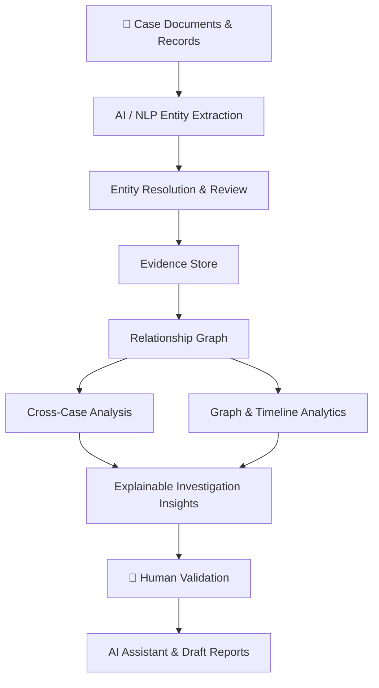

## CrimeIntel 🔎
### AI-Powered Criminal Network Analysis & Investigation

**Connecting evidence. Discovering relationships. Supporting smarter investigations.**

CrimeIntel is an AI-powered investigation support platform designed to help law enforcement analyze crime-related records, discover potential connections across cases, and visualize criminal networks through explainable, evidence-backed insights.

Instead of manually examining disconnected documents and records, investigators can explore entities, relationships, timelines and related cases through a unified workspace—with **human validation at the center of every AI-suggested connection**.

> ⚠️ **Prototype notice:** CrimeIntel is an investigation-support prototype. AI-generated suggestions are leads for human review, not proof of guilt.

## 📑 Quick Navigation

- [✨ Features](#-key-features)
- [⚙️ How It Works](#️-how-it-works)
- [🛠️ Technology](#️-technology)
- [🚀 Getting Started](#-getting-started)
- [🔮 Future Scope](#-future-scope)

## ✨ Key Features

| Feature | What it does |
|---|---|
| 📄 **Document Intelligence** | Processes case documents and extracts relevant entities such as people, locations, vehicles and phone numbers. |
| 🔗 **Entity Resolution** | Identifies possible duplicate identities and helps investigators review potential matches. |
| 🕸️ **Criminal Network Graph** | Visualizes relationships among entities, incidents and cases. |
| 🧩 **Cross-Case Linking** | Identifies potential connections using shared entities and available temporal, spatial or semantic similarities. |
| 🔍 **Explainable Evidence** | Connects suggested relationships to their source records, confidence information and validation status. |
| 📅 **Temporal Analysis** | Organizes case events and evidence chronologically. |
| 📊 **Investigation Dashboard** | Presents case statistics, alerts, pending reviews and analytical summaries. |
| 🗺️ **Location-Based Analysis** | Supports geographical exploration of incidents when location data is available. |
| 🤖 **AI Investigation Assistant** | Helps users query authorized case information and retrieve evidence-grounded summaries. |
| 📝 **Draft Report Assistance** | Helps prepare structured investigation drafts using available case records and source references. |
| 🔐 **Role-Based Access** | Restricts access to cases and actions according to user permissions. |

## 🏛️ Platform Architecture

```mermaid
flowchart TD
    A["CrimeIntel Platform"] --> B["Administrator View"]
    A --> C["Investigator View"]

    B --> D["Executive Dashboard"]
    B --> E["Crime Records & Analytics"]
    B --> F["Location-Based Crime Map"]
    B --> G["Officer Workload & Statistics"]

    C --> H["Investigator Dashboard"]
    C --> I["My Cases & Crime Records"]
    C --> J["Register FIR & Add Evidence"]
    C --> K["Network Graph & Entity Analysis"]
    C --> L["Forensic Case Comparison"]
    C --> M["Review Queue & Timeline"]
    C --> N["AI Investigation Assistant"]

    D --> O["District-Level KPIs, Trends & Case Aging"]
    E --> P["Case Search, Filters & Inspection"]
    F --> Q["Incident Locations, Clusters & Heatmap"]
    G --> R["Caseload & Active Tasks"]

    K --> S["Relationships, Communities & Centrality"]
    L --> T["MO, Temporal, Spatial & Semantic Comparison"]
    M --> U["Evidence Validation & Audit Trail"]
    N --> V["Evidence-Grounded Answers & Draft Reports"]

    classDef root fill:#153746,color:#ffffff,stroke:#153746
    classDef admin fill:#e6f8fa,color:#153746,stroke:#0ea5b7
    classDef investigator fill:#eef4f7,color:#153746,stroke:#628796
    classDef detail fill:#ffffff,color:#18323d,stroke:#d8e4e8

    class A root
    class B,D,E,F,G admin
    class C,H,I,J,K,L,M,N investigator
    class O,P,Q,R,S,T,U,V detail
```


### ⚙️ How It Works



1. **Ingest:** Add FIR documents and other investigation records.
2. **Extract:** Identify entities and relevant information.
3. **Connect:** Build evidence-backed relationships and examine potential cross-case links.
4. **Analyze:** Explore network structure, timelines and geographical patterns.
5. **Validate:** Let authorized investigators review AI-suggested connections.
6. **Assist:** Retrieve relevant evidence and prepare structured summaries or drafts.

## 🛠️ Technology Stack

### 🖥️ Frontend

- **HTML5, CSS3 & Vanilla JavaScript (ES6+)** — responsive interface and interactive investigation workflows.
- **Vis-Network** — interactive criminal network graphs, relationship exploration and ego-network visualization.
- **Leaflet.js (v1.9.4) & OpenStreetMap** — location-based incident mapping and geographical analysis.
- **Chart.js (v4.x)** — case statistics, incident trends and forensic comparison charts.

### ⚙️ Backend & API

- **Python 3.10+ & FastAPI** — backend logic and REST API endpoints.
- **Uvicorn** — ASGI server for running the application.
- **Pydantic v2** — request validation and structured API data.
- **HTTPX** — asynchronous HTTP communication with services such as the local LLM.
- **python-dotenv** — environment variable and configuration management.

### 💾 Data Management

- **Pandas** — in-memory data processing, filtering, querying and relational joins.
- **CSV datasets** — structured storage for cases, persons, relationships, documents, events, evidence, vehicles, phone numbers and audit records.

### 🕸️ Graph & Network Analytics

- **NetworkX** — construction and analysis of entity relationship networks.
- **Degree Centrality** — measures how connected an entity is within a network.
- **Betweenness Centrality** — identifies nodes that act as bridges between parts of a network.
- **Greedy Modularity Community Detection** — discovers densely connected groups.
- **Ego-Network Analysis** — explores an entity's immediate connections and multi-hop neighborhood.

### 🤖 AI, NLP & Intelligence Correlation

- **Regex and rule-based extraction** — identifies structured information such as Indian vehicle registration numbers and mobile numbers.
- **RapidFuzz** — fuzzy matching and entity resolution for possible aliases and duplicate records.
- **Multi-factor case similarity** — compares modus operandi (MO), geographical proximity, temporal intervals and narrative similarity.
- **Haversine distance calculation** — estimates geographical distance between coordinates.

### 🔐 Security & Access Control

- **Role-Based Access Control (RBAC)** — separates Administrator and Investigator permissions.
- **Password hashing and session tokens** — supports authentication and session management.
- **Audit logging** — records important actions, including logins, FIR registration, evidence additions and relationship validation.

## 🚀 Getting Started

### Method 1: PowerShell Script (Recommended)
From the project root folder:
```powershell
.\run_prototype.ps1
```
*(This starts the Uvicorn FastAPI server at `http://127.0.0.1:8000` and automatically launches your default web browser.)*

### Method 2: Windows Batch File
Double-click `run_prototype.bat` in File Explorer, or run in Command Prompt:
```cmd
run_prototype.bat
```

### Method 3: Direct Python Launch
```powershell
py -m uvicorn backend.main:app --host 127.0.0.1 --port 8000
```

**CrimeIntel is designed to support investigative judgment—not replace it.**

## 🔮 Future Scope

- Authorized integration with relevant government information systems.
- Improved OCR and multilingual document processing.
- More advanced spatial-temporal and semantic case analysis.
- Enhanced evidence retrieval and report generation.
- Scalable deployment, monitoring and security controls.

## 🎯 Our Vision

To transform fragmented crime-related information into **connected, explainable and actionable investigative insights**, helping investigators examine complex cases more efficiently while maintaining evidence traceability and human oversight.
